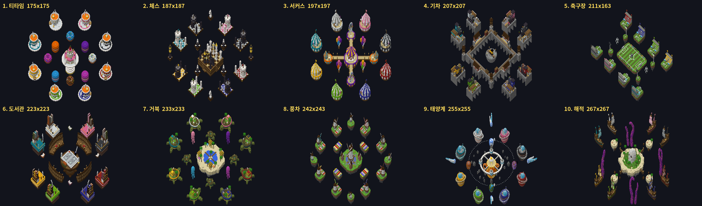

# 배드워즈 타이쿤

마인크래프트 자바 26.3용 데이터팩 하나로 된 게임. 공허 월드에 로비 1개와 8팀 배드워즈 맵 5개를 깔고, 그 위에서 **컴퓨터 7팀과 배드워즈**를 한다.
이기면 코인을 받고, 코인으로 상점 물건·팀 업그레이드·맵을 해금한다. 이길수록 상대가 강해지고, 로비 어딘가에 숨은 암시장에서는 "핵"을 판다.
리소스팩 없음, 디스플레이 엔티티 없음.



## 한 판의 흐름

1. 로비 성벽의 문으로 들어가면 그 맵이 원래 모습으로 되돌아가고 판이 시작된다. 플레이어는 **빨강 팀**, 나머지 7팀은 봇 1명씩.
2. 규칙은 배드워즈 그대로: 기지 생성기에서 철·금, 섬의 생성기에서 다이아몬드·에메랄드. 침대가 있으면 5초 뒤 부활, 없으면 탈락. 마지막까지 남으면 승리.
3. 판이 끝나면 8초 뒤 로비로 돌아온다. `/trigger lobby` 를 치면 그 판을 포기한다.
4. 가진 코인이 목표(기본 10,000)를 넘으면 엔딩. 목표는 `/scoreboard players set #goal bw <숫자>` 로 바꾼다.

밤눈(야간 투시)은 로비에서도 게임에서도 항상 켜져 있다. 배고픔은 없고, 체력은 4초에 반 칸쯤 찬다. 검은 1.8처럼 쿨타임이 없다.

### 시간표 (하이픽셀 솔로·더블 기준)

| 자원 | 간격 | 쌓이는 최대 |
| --- | --- | --- |
| 철 (기지) | 1초 | 48 |
| 금 (기지) | 6초 | 8 |
| 다이아몬드 I / II / III | 30초 / 23초 / 12초 | 4 |
| 에메랄드 I / II / III | 65초 / 50초 / 30초 | 2 |

| 시각 | 일 |
| --- | --- |
| 6:00 / 18:00 | 다이아몬드 II / III |
| 12:00 / 24:00 | 에메랄드 II / III |
| 30:00 | 남은 침대 전부 파괴 |
| 40:00 | 서든 데스 (모두가 서서히 피해) |
| 50:00 | 게임 종료 |

다이아몬드 I 30초·최대 4개, 에메랄드 I 65초·최대 2개, 팀 업그레이드 가격은 하이픽셀 위키에서 확인한 값이다.
나머지(철·금 간격, II·III 단계 간격, 시간표)는 기억하고 있는 값이라 실제와 조금 다를 수 있다. 전부 `gen3/game.py` 맨 위에 있다.

## 상점 (상자 창)

기지의 상인 앞 **구리 상자**를 우클릭하면 6줄짜리 창이 열린다. 맨 윗줄이 분류, 그 아래가 물건이고, 물건을 누르면 바로 산다 (shift-클릭, 숫자 키도 된다).
살 수 있으면 이름이 초록, 자원이 모자라면 빨강, 아직 해금 안 한 물건은 회색 염료로 보인다.

- **아이템 상점**: 빠른 구매 / 블록 / 근접 무기 / 방어구 / 도구 / 원거리 / 물약 / 유틸리티. 가격은 하이픽셀 기준 (`gen3/items.py`).
- **팀 업그레이드** (다이아몬드): 날카로운 검 4, 강화 갑옷 2·4·8·16, 광란의 광부 2·4, 용광로 2·4·6·8, 치유의 샘 1, 함정 1.
- 화염구는 우클릭으로 쏘고, TNT는 놓자마자 불이 붙고, 다리 알은 던진 길에 양털 다리가 생긴다.
- 폭발은 플레이어가 놓은 블록만 부순다 (화염구: 양털·판자·점토·사다리, TNT: 거기에 엔드 스톤까지. 유리와 흑요석은 안 부서진다).
- 빈대, 드림 디펜더, 마법 우유, 팝업 타워는 넣지 않았다.

상자 창은 진짜 이중 상자다. 물건 그림마다 번호가 붙어 있고, 그림이 상자를 떠나는 순간(집어 듦, 옮김, 버림) 데이터팩이 그것을 지우고 번호에 맞는 구매를 한 뒤 상자를 다시 그린다.
상자에 넣은 물건은 바로 튀어나온다. 상인을 직접 누르면 "앞의 상자를 열어"라고만 한다 (바닐라에서 주민을 눌러 상자 창을 열 방법은 없다).

플레이어는 모험 모드다. 상점에서 산 블록만 놓을 수 있고, 플레이어가 놓는 종류의 블록과 침대만 부술 수 있다. 맨손으로는 못 부순다 (검이든 블록이든 뭔가 들어야 한다).
맵에 원래 있던 양털·점토·사다리도 같은 종류라 부술 수 있는데, 판이 시작될 때마다 맵 전체가 원래대로 돌아온다. **그래서 맵에 손으로 고친 것도 판이 시작되면 사라진다.**

## 코인과 해금

| 한 일 | 코인 |
| --- | --- |
| 처치 | 5 |
| 최종 처치 | 15 |
| 침대 파괴 | 30 |
| 승리 | 100 |
| 참가 | 10 |

단계마다 +25%, 큰 맵이면 거기에 더 붙는다.

| 맵 | 크기 | 해금 | 코인 보너스 |
| --- | --- | --- | --- |
| 티타임 | 137x137 | 처음부터 | - |
| 체스 | 157x157 | 250 | +15% |
| 서커스 | 177x177 | 600 | +30% |
| 도서관 | 223x223 | 1,200 | +50% |
| 태양계 | 267x267 | 2,500 | +75% |

로비 스폰 광장 서쪽 오두막(업그레이드 가게)의 상자에서 해금한다. 윗줄 분류는 아이템 상점과 같고 9번째가 팀 업그레이드, 맨 아랫줄이 맵이다.
처음부터 살 수 있는 건 양털, 돌 검, 가위, 곡괭이뿐이다. 나머지는 30~450 코인.

## 상대 (AI)

이길 때마다 **단계**가 1 오르고, 봇은 그 단계만큼 잘한다.

| 단계 | 봇 |
| --- | --- |
| 0~3 | 사거리가 짧고(2.7~3.0칸) 절반도 못 맞힘. 걸어 다니고, 웅크리고 천천히 다리를 놓음. 사슬 갑옷·나무 곡괭이 정도. 침대 방어 없음 → 양털 |
| 4~7 | 달리고, 옆으로 돌면서 싸우고, 철 장비 → 다이아 검을 삼. 엔드 스톤 + 양털 방어. 황금 사과·화염구를 씀 |
| 8~11 | 빠른 다리, 다이아 갑옷·곡괭이와 팀 업그레이드, 엔드 스톤 + 나무 방어, 함정 |
| 12~14 | 흑요석 방어, 열 번에 아홉 번 맞힘 |
| 15~ | **핵**: 사거리 3.7 → 4.5, 넉백을 거의 안 받음, 달리면서 앞을 보고 다리를 놓음(스캐폴드), 낙하 피해 없음 |

봇은 마네킹(플레이어 모양 엔티티)이다. 걷기는 투구에 붙은 마법 부여가 매 틱 앞으로 조금씩 미는 것으로 한다. 플레이어가 걷는 것과 같은 방식이라 넉백·마찰·점프가 사람과 똑같이 먹는다.
기지에서 자원을 모으고 → 상점에 가서 사고 → 침대를 둘러싸고 → 이웃이나 플레이어의 침대로 다리를 놓고 → 블록을 캐서 침대를 부순다. 죽으면 검을 잃고 5초 뒤 부활한다.
섬 사이의 길은 팩을 만들 때 맵에서 미리 계산해 둔다 (`gen3/nav.py`). 싸우다가 길에서 벗어나면 자기가 온 발자국을 거꾸로 밟아 돌아가고,
벽에 막히면 벽을 따라 돌다가 길이 열리면 다시 간다. 그래도 못 가면 (같은 곳을 일곱 번 돌아가려다 실패하거나 20~50초가 지나면)
다음 지점으로 옮겨진다. 드물지만 그때는 순간이동처럼 보인다.

## 암시장

로비 어딘가에 숨어 있다. 맵마다 다이아몬드 생성기 옆에 서 있는 `수상한 떠돌이`가 한 줄씩 힌트를 준다.
여기서 파는 건 진짜 핵이 아니고, 그 핵을 켰을 때 보이는 것을 데이터팩이 대신 해 주는 것이다. 산 핵은 상자 아래 줄의 염료로 켜고 끈다.

| 선반 | 조건 | 핵 (코인) | 여기서 하는 일 |
| --- | --- | --- | --- |
| 초급 | 3단계 | Velocity: jump 150 → reduce 300 | 넉백 20% → 45% 감소 |
| | | Reach: 3.1 120 → 3.5 300 → 4.0 600 | 사거리가 그만큼 늘어남 |
| | | Eagle: 0.2 80ms 100 → 0.3 50ms 250 | 블록을 들고 가장자리에 서면 느려지고, 넘어가면 되돌려 놓음 |
| | | Aim Assist: normal 200 → silent 500 | normal: 조준이 적 쪽으로 끌려감 / silent: 검의 판정이 넓어짐 |
| | | AutoClicker 350 | 검을 들고 조준하고 있으면 알아서 때림 |
| | | AutoBlock: Legit 200 → Lag block 450 | 봇에게 맞는 피해 25% → 50% 감소 |
| | | Knockback Displace: 90degree 250 → void 600 | 때린 봇이 옆으로 / 가까운 낭떠러지 쪽으로 날아감 |
| | | Anti Fireball 200 | 날아오는 화염구를 보는 쪽으로 되받아침 |
| 고급 | 6단계 + 초급 4개 | Velocity (0 100) 900 | 넉백 없음 |
| | | Scaffold: Tower(vanilla) 1,000 → Keep Y 1,500 | 가방의 블록이 발밑에 깔림. 제자리 점프로 탑. Keep Y는 뛰면서 가도 같은 높이 |
| | | Lag range: 100ms 700 → 200ms 1,200 | 사거리 +0.56 → +1.12 |
| | | Stasis 800 | 공허로 떨어지면 3초 동안 떠오름 (30초에 한 번) |
| 최종장 | 9단계 + 고급 3개 | Tower: fly x1.5 1,500 → x3 2,500 | 점프를 누르고 있으면 블록을 깔며 빠르게 올라감 |
| | | NoFall 1,200 | 낙하 피해 없음 |
| | | FB Longjump 2,000 | 화염구를 발밑을 보고 쓰면 피해 없이 20칸쯤 날아감 |
| | | TP Aura 3,500 | 검을 들고 있으면 14칸 안의 봇에게 순간이동해서 때림 |

Stasis는 원래 뜻을 확인하지 못해서 "공허 방지"로 만들었다.

## 설치

- `datapack/bedwars_maps.zip` 을 월드의 `datapacks` 폴더에 넣고 월드에 들어가면 알아서 설치된다 (1분쯤).
- 예전 버전이 깔려 있던 월드면 로비와 맵을 지우고 새로 깐다 (1~2분, 그동안 플레이어는 로비에 모아 둔다).
- 다시 깔기: `/function bw:reinstall`.
- 새 공허 월드 폴더 만들기: `python3 gen/world.py <saves 폴더> datapack/bedwars_maps.zip` (`BW_TEMPLATE` 에 26.3 월드 하나의 level.dat 과 data/minecraft/*.dat 필요).

시험할 때 쓸 만한 명령:

```
/scoreboard players set @s bw.coins 5000     코인
/scoreboard players set @s bw.stage 16       단계 (봇 수준)
/tag @s add bw.m.solar                        맵 해금 (tea, chess, circus, library, solar)
/function bw:game/close                       판 끝내고 로비로
```

## 만드는 법

```
pip install nbtlib numpy pillow
cd gen3 && python3 pack.py            # out3/bedwars_maps.zip (길 계산 때문에 처음엔 2분쯤)
```

| 파일 | 하는 일 |
| --- | --- |
| `m01_tea.py` … `m09_solar.py`, `lobby.py`, `kit.py`, `canvas.py` | 건축 (블록을 코드로 쌓아 구조물 파일로 저장) |
| `check.py` | 블록 상태·물리·마커·걸어서 닿는지 검사 |
| `nav.py` | 봇이 다닐 길과 침대 방어 블록 자리 |
| `game.py` | 판의 진행: 시작, 생성기, 침대, 죽음과 부활, 승패, 코인, 로비 |
| `items.py`, `gui.py` | 상점 물건과 상자 창 (아이템 상점, 팀 업그레이드, 해금) |
| `ai.py` | 봇, 화염구·TNT·다리 알 |
| `hacks.py` | 암시장과 핵 |
| `pack.py` | 전부 묶어서 설치 과정과 함께 팩으로 |

`tools/` 는 26.3 서버에 가짜 플레이어로 접속해서 시험하는 스크립트다 (`gt.py`, `bwbot.py`; 접속 부분은 `steve-eokka/tools/bot.py`).
`tools/tests/` 에 시험 하나하나가 있다: 한 판의 흐름(`round.py`), 상점(`shop.py`), 해금과 암시장(`unlock_blackmarket.py`), 핵(`hacks.py`),
맵 잠금(`maplock.py`), 블록 놓기·부수기(`adventure.py`), 엔딩(`ending.py`), 월드를 닫았다 열기(`reload.py`), 힌트 NPC(`hint.py`),
봇이 멈춰 서는 곳 찾기(`stalls.py`, `stuck.py`, `roof.py`), 봇 하나를 원하는 자리에 놓고 보기(`onebot.py`, `tickstep.py`).
경로가 내 시험 서버 기준(`/home/claude/...`, `/tmp/bwout`)이라 다른 곳에서 돌리려면 맨 위의 경로를 바꿔야 한다.

## 맵의 마커

맵마다 marker 엔티티가 들어 있다 (태그 `bw`).

| 태그 | 맵당 개수 | 위치 |
| --- | --- | --- |
| `bw.spawn` | 8 | 팀 스폰 |
| `bw.bed` | 8 | 침대 |
| `bw.gen.iron` | 8 | 팀 생성기 |
| `bw.gen.diamond`, `bw.gen.emerald` | 4씩 | 다이아 / 에메랄드 생성기 |
| `bw.shop`, `bw.upgrade` | 8씩 | 상인 자리 |
| `bw.gui` + `bw.gui.shop` / `bw.gui.team` | 16씩 | 상점 상자 (반쪽마다 하나) |

팀 마커에는 `bw.t.<색>` (red, blue, lime, yellow, cyan, white, pink, gray) 이 붙는다.
